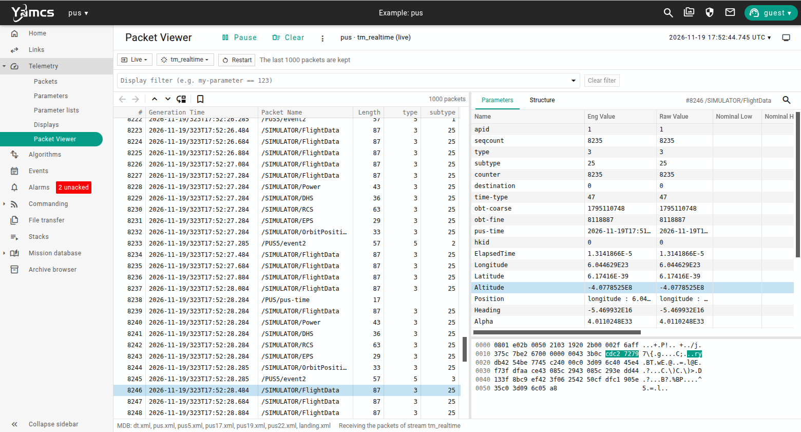

# Yamcs Web Packet Viewer

The Yamcs packet viewer in Yamcs-web: **Telemetry → Packet Viewer**. The packets of a Yamcs stream (live), of the
Yamcs archive or of a local file are decoded in the browser, in a Web Worker running WebAssembly built on
[xtce-rs](https://crates.io/crates/xtce-rs). It works like the Java packet viewer of Yamcs (`packet-viewer`): same packets table,
display filter, parameters, structure and hex dump.



| directory | what |
|---|---|
| `core/` | `pv-core`: the viewer in Rust (file formats, preprocessors, naming, filter, details), tested against the Java viewer |
| `wasm/` | `pv-wasm`: the WebAssembly module, its worker and the JavaScript client ([docs/protocol.md](docs/protocol.md)) |
| `web/` | the Yamcs-web extension (Angular) |
| `plugin/` | the Yamcs plugin `com.jaops.yamcs:web-packet-viewer`: serves the UI, the configuration and the MDB ([docs/plugin.md](docs/plugin.md)) |
| `dev/` | a Yamcs with the plugin and the PUS simulator, for development ([dev/README.md](dev/README.md)) |
| `tools/golden/` | the Java side of the golden tests |

## Adding it to Yamcs

The plugin needs Yamcs 5.14 with Yamcs-web. In a Maven project (`yamcs-maven-plugin`), add the dependency to
`pom.xml`:

```xml
<dependency>
  <groupId>com.jaops.yamcs</groupId>
  <artifactId>web-packet-viewer</artifactId>
  <version>0.1.0</version>
</dependency>
```

Otherwise put the jar in Yamcs's `lib/`. Nothing else is needed: the plugin loads itself and **Packet Viewer**
appears under Telemetry for the users who may read packets. An optional `packetViewer:` section of `yamcs.yaml`
sets the live stream, the number of packets kept, the file formats and more ([docs/plugin.md](docs/plugin.md)):

```yaml
packetViewer:
  stream: tm_realtime
  liveMaxLines: 1000
```

## Build

Needs Rust with the `wasm32-unknown-unknown` target, Node 24, Java 17 and Maven.

```bash
(cd web && npm install && npm run wasm && npm run build)
(cd plugin && mvn install)
```

The jar is `plugin/target/web-packet-viewer-*.jar`.

## Tests

```bash
cargo test                                # pv-core, golden tests (tools/golden/run.sh first)
(cd wasm && node test/e2e.mjs && node test/perf.mjs)
(cd web && npm run e2e)                   # against dev/yamcs
```
